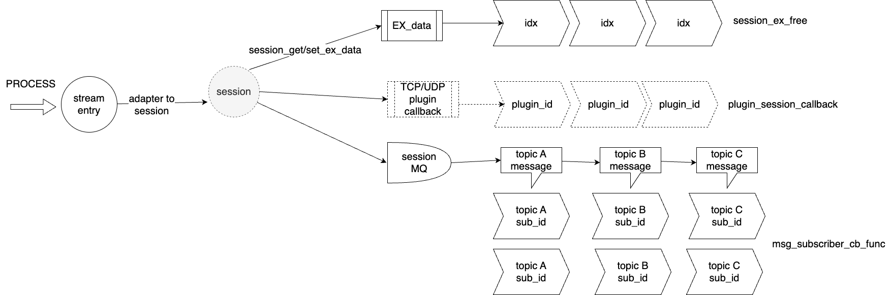
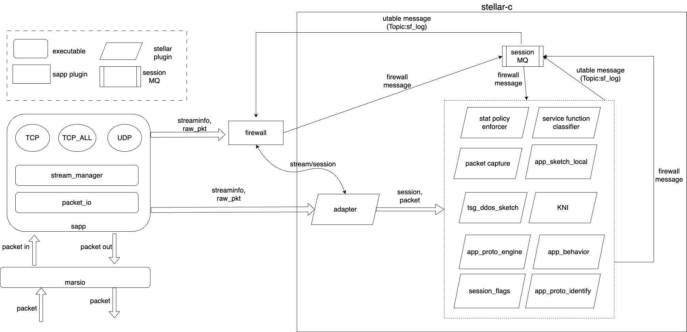
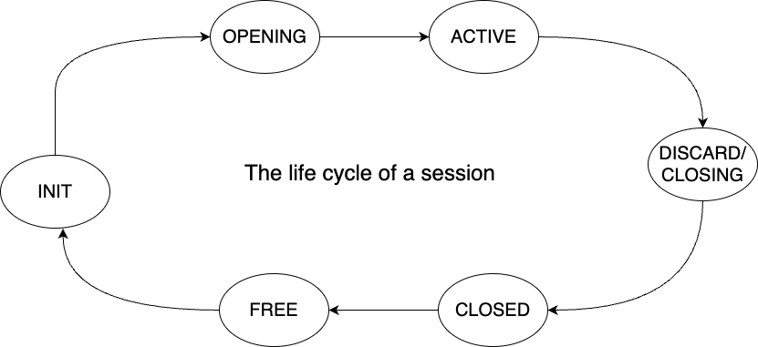

# Stellar-C: c adapter for stellar
## Concepts
The Stellar-C is a transition solution from Sapp to Stellar for fast DPI plugin development. The Stellar-C is built on the concepts of sessions and messages. A session is defined as a sequence of packets that share the same traffic attributes, such as TCP or UDP sessions. 
* Each session has a message queue, which facilitates the exchange of messages among plugins. The message delivery is in the session scope. In Stellar-C, plugins are decoupled through the publish-subscribe mechanism.
* EXdata (Extra Data) is attached to a session for plugin context management.

## Components
The Stellar-C consists of the following components:
* Sapp adaptor converts a Sapp stream to a Stellar session, and calls Stellar plugins to process the session.
* Firewall is a Sapp plugins that interact with TCP/UDP and L7 decoders. It inherits all TSG firewall functions and publish messages to Stellar plugins.
* Stellar plugins are DPI plugins that process the session, such as AppSketch, Session Flagging, Session Recorder.
* Common libraries are shared libraries that are used by Stellar plugins, such as utable, logger.
* Test framework generates sessions and messages from different data source for testing Stellar plugins. Possible data sources include pcap file, Kafka message queue, and fuzzing data.

## The Lifecycle of a Session

